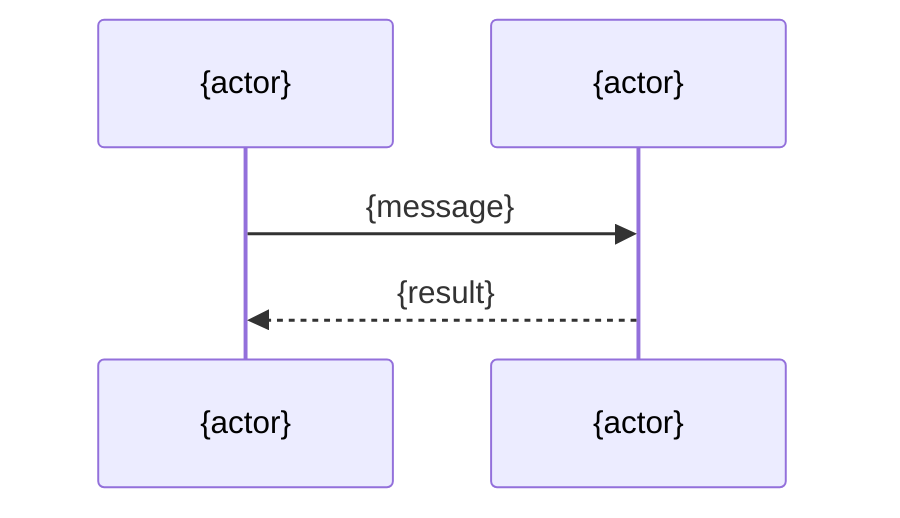

# {id} {Title}

| | |
|---|---|
| Work | {feature, fix, or rollback}: {one line} |
| Change | `{short hash or range}` on `{branch}`, {date} |
| Evidence | {intent record path, or "commit messages only"} |
| Reader | A learner who can write basic code and is new to this stack |

This document obeys the rules of ASD-STE100 Simplified Technical
English. It is not a certified STE document.

## 1. Summary

<!-- 3 to 5 sentences: what the work does, who uses it, and the one idea to remember. -->

## 2. Why this work exists

<!-- The problem. What the system did before. What goes wrong without this work. -->

## 3. Design

<!-- One sentence on the shape of the design, then the parts. Each part has one job. -->

| Part | Location | Job |
|---|---|---|
| {name} | `{path}` | {one sentence} |

```mermaid
flowchart LR
  A[{part}] --> B[{part}]
```

## 4. Workflow

<!-- One trace. State the real input, then follow it from the entry point to the result. -->

Example input: {a real input}

1. {Who or what} {does what}. (`{path}:{line}`)
2. {Next step}.



## 5. Decisions and tradeoffs

### 5.1 {The decision, as a statement}

- **Choice:** {what the work does}
- **Alternatives:** {what it could do as an alternative}
- **Reason:** {Recorded or Inferred}: {the reason}. Source: {where}.
- **Cost:** {what this choice makes harder, slower, or leaves out}

## 6. Blast radius

### 6.1 This work needs

| Dependency | Used for | If it fails |
|---|---|---|
| {service, table, variable, library} | {purpose} | {what the user sees and what stops} |

### 6.2 These things use this work

| Consumer | Uses | Found in |
|---|---|---|
| {caller} | {interface} | `{path}:{line}` |

<!-- Write "No consumers yet." when the search finds none. -->

### 6.3 If you change this work

| If you change | Then check |
|---|---|
| {interface or behavior} | {what can break, and where} |

### 6.4 How to remove this work

<!-- The steps to take it out safely: what to revert, what data or config stays behind. -->

## 7. Code reading path

<!-- 5 to 10 stops, in the order that makes the design clear. -->

1. [`{path}:{line}`](../{path}#L{line}) - Look for: {what this stop teaches}.

## 8. Known limits

<!-- What the work does not do, open findings, and defects seen during the debrief. -->

- {limit}

## 9. Self-test

1. {A "why" or "what happens if" question}

<details>
<summary>Answers</summary>

1. {Answer}. See section {n}.

</details>
